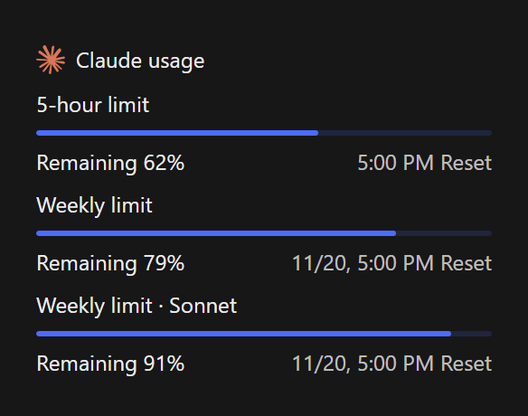
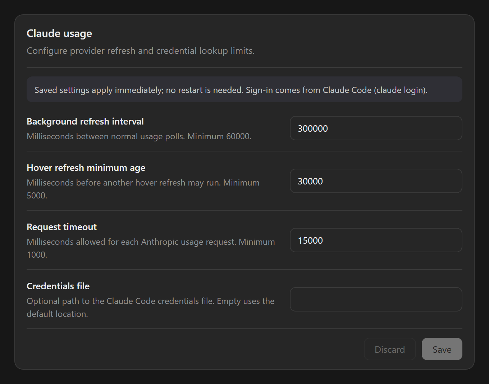

# Claude usage for DeepSeek Harness

English | [简体中文](README.zh.md)

See how much of your Claude plan you have left without leaving DeepSeek Harness. A card at the bottom of the sidebar shows your 5-hour limit, your weekly limit, any per-model weekly limit, and when each one resets.

<p align="left">
  
</p>

This is a fork of [leonardoxr/dsh-claude-usage](https://github.com/leonardoxr/dsh-claude-usage), updated for DeepSeek Harness 0.2 and restyled to match the [dsh-codex-usage](https://github.com/sodaa-l/dsh-codex-usage) card, so the two sit together neatly.

## What you need

- DeepSeek Harness 0.2.2 or newer (the desktop app or `dsh web`)
- Claude Code, signed in with a Claude Pro or Max subscription
- Windows or Linux. macOS isn't supported yet, because Claude Code keeps its sign-in in the macOS Keychain.
- Node.js 22+ and pnpm 10, to build the plugin

## Install

```sh
git clone https://github.com/jutochoppa/dsh-claude-usage.git
cd dsh-claude-usage
pnpm install
pnpm pack
dsh plugin --profile desktop add ./dsh-claude-usage-0.2.3.tgz
```

Then quit DeepSeek Harness completely and open it again. The card appears at the bottom of the sidebar.

- **Using the web version?** Use `--profile web` instead of `--profile desktop`, then start it with `dsh web`.
- **`dsh` not found on Windows?** The desktop app includes it at `%LOCALAPPDATA%\Programs\DeepSeek Harness\resources\runtime\cli\bin\dsh.cmd`.
- **To uninstall:** `dsh plugin --profile desktop remove dsh-claude-usage`

## Sign in

The plugin has no login of its own. It uses your Claude Code sign-in:

1. Open Claude Code by running `claude` in a terminal.
2. Type `/login` and finish signing in.

Claude Code saves your sign-in to `~/.claude/.credentials.json`, and the plugin reads it from there. Signing in to the Claude desktop app is not enough, because the desktop app stores its sign-in separately.

Claude Code's sign-in only lasts about 8 hours at a time. When it runs out, the plugin asks Claude Code to renew it by running `claude auth status` in the background, exactly as if you ran it yourself. Claude Code does the renewing and saves the result; the plugin never touches your refresh token. For this to work, `claude` must be on your PATH or in `~/.local/bin`, where the Claude Code installer puts it.

If the card still asks you to sign in, run `claude auth status` yourself. If that says you're signed out, run `/login` in Claude Code.

## Reading the card

- **Remaining X%** is how much of that limit you have left. The bar shows the same thing.
- **The time on the right** is when that limit resets.
- The card checks your usage every 5 minutes. Hovering over it checks right away.
- With the sidebar collapsed, the card uses short labels like "5h" and "62% left".

## Settings

Open **Settings → Plugins → Claude usage**. Changes take effect as soon as you save.

<p align="left">
  
</p>

| Setting | Default | What it does |
| --- | --- | --- |
| Background refresh interval | 300000 ms (5 minutes) | How often the card checks your usage. Minimum is 1 minute. |
| Hover refresh minimum age | 30000 ms (30 seconds) | Hovering won't check more often than this. |
| Request timeout | 15000 ms (15 seconds) | How long to wait for Anthropic before giving up. |
| Credentials file | empty | Only needed if your Claude Code credentials aren't in the usual place. |

## Privacy

- Your Claude Code token stays on your computer. The plugin reads it and sends it only to Anthropic (`api.anthropic.com`) to ask for your usage. It never saves, changes, or logs the token, and it never reads your refresh token. When the token expires, Claude Code renews it, not the plugin.
- The sidebar only receives percentages, reset times, and your plan name. No tokens, emails, or account IDs.
- The usage numbers come from the same Anthropic endpoint that Claude Code's `/usage` command uses. Anthropic hasn't documented it publicly, so it could change without warning.

## Development

```sh
pnpm run check   # type check, build, and run the tests
```

To test against your real account (Claude Code must be signed in), in PowerShell:

```powershell
$env:CLAUDE_LIVE = '1'
pnpm exec vitest run tests/claude-live.spec.ts
```

The screenshots in `assets/` were rendered from the plugin's real components using made-up numbers.

## Credits and license

- Original plugin by [leonardoxr](https://github.com/leonardoxr/dsh-claude-usage).
- Card layout follows [dsh-codex-usage](https://github.com/sodaa-l/dsh-codex-usage) by sodaa-l.
- Claude and the Claude logo belong to Anthropic. This project is not affiliated with Anthropic or DeepSeek.

MIT license. See [LICENSE](LICENSE).
