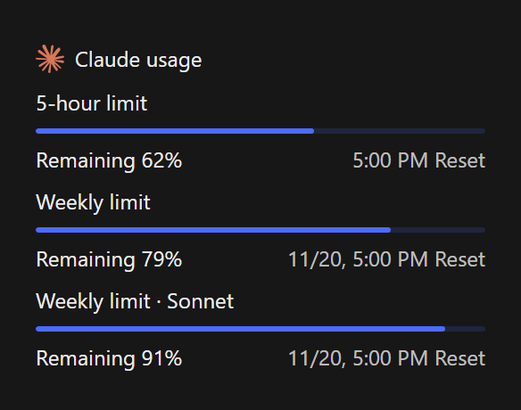
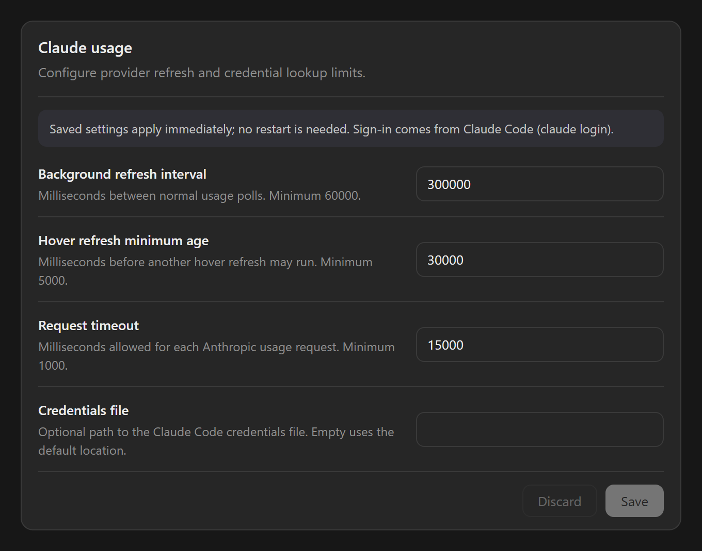

# DeepSeek Harness 的 Claude 用量插件

[English](README.md) | 简体中文

不用离开 DeepSeek Harness，就能看到 Claude 套餐还剩多少额度。侧栏底部的卡片会显示 5 小时额度、每周额度、按模型计算的每周额度，以及每项的重置时间。

<p align="left">
  
</p>

本项目 fork 自 [leonardoxr/dsh-claude-usage](https://github.com/leonardoxr/dsh-claude-usage)，已适配 DeepSeek Harness 0.2，并改为与 [dsh-codex-usage](https://github.com/sodaa-l/dsh-codex-usage) 一致的卡片样式，两张卡片放在一起风格统一。

## 需要准备

- DeepSeek Harness 0.2.2 或更高版本（桌面应用或 `dsh web`）
- 已用 Claude Pro 或 Max 订阅登录的 Claude Code
- Windows 或 Linux。暂不支持 macOS，因为 Claude Code 在 macOS 上把登录信息存在钥匙串里。
- 构建插件需要 Node.js 22+ 和 pnpm 10

## 安装

```sh
git clone https://github.com/jutochoppa/dsh-claude-usage.git
cd dsh-claude-usage
pnpm install
pnpm pack
dsh plugin --profile desktop add ./dsh-claude-usage-0.2.2.tgz
```

然后完全退出 DeepSeek Harness 再重新打开，卡片就会出现在侧栏底部。

- **使用网页版？** 把 `--profile desktop` 换成 `--profile web`，再用 `dsh web` 启动。
- **Windows 上找不到 `dsh`？** 桌面应用自带该命令，位置是 `%LOCALAPPDATA%\Programs\DeepSeek Harness\resources\runtime\cli\bin\dsh.cmd`。
- **卸载：** `dsh plugin --profile desktop remove dsh-claude-usage`

## 登录

插件本身没有登录功能，它使用 Claude Code 的登录信息：

1. 在终端运行 `claude` 打开 Claude Code。
2. 输入 `/login` 并完成登录。

Claude Code 会把登录信息保存到 `~/.claude/.credentials.json`，插件从这里读取。只登录 Claude 桌面应用是不够的，因为桌面应用把登录信息单独保存。

Claude Code 的登录每次只能维持大约 8 小时。过期后，插件会在后台运行 `claude auth status`，让 Claude Code 自己续期，效果和你手动运行一样。续期和保存都由 Claude Code 完成，插件从不接触你的 refresh token。为此，`claude` 需要在 PATH 中，或位于 Claude Code 安装程序默认放置的 `~/.local/bin`。

如果卡片仍然提示需要登录，请自己运行一次 `claude auth status`。如果它显示你已退出登录，就在 Claude Code 中运行 `/login`。

## 卡片怎么看

- **Remaining X%** 表示这项额度还剩多少，进度条显示的是同一个数字。
- **右侧的时间** 是这项额度的重置时间。
- 卡片每 5 分钟检查一次用量，鼠标移到卡片上会立即检查。
- 侧栏收起时，卡片会使用 "5h"、"62% left" 这样的简短标签。

## 设置

打开 **Settings → Plugins → Claude usage**。保存后立即生效。

<p align="left">
  
</p>

| 设置 | 默认值 | 作用 |
| --- | --- | --- |
| Background refresh interval | 300000 毫秒（5 分钟） | 卡片多久检查一次用量，最短 1 分钟。 |
| Hover refresh minimum age | 30000 毫秒（30 秒） | 鼠标悬停触发检查的最短间隔。 |
| Request timeout | 15000 毫秒（15 秒） | 等待 Anthropic 响应的最长时间。 |
| Credentials file | 空 | 只有 Claude Code 登录文件不在默认位置时才需要填写。 |

## 隐私

- Claude Code 的令牌只留在你的电脑上。插件读取令牌后，只把它发给 Anthropic（`api.anthropic.com`）查询用量，不会保存、修改或记录令牌，也从不读取你的 refresh token。令牌过期时由 Claude Code 自己续期，而不是插件。
- 侧栏只会收到百分比、重置时间和套餐名称，不包含令牌、邮箱或账号 ID。
- 用量数据来自 Claude Code 的 `/usage` 命令所用的同一个 Anthropic 接口。Anthropic 没有公开这个接口的文档，它可能随时变化。

## 开发

```sh
pnpm run check   # 类型检查、构建并运行测试
```

用真实账号测试（需要 Claude Code 已登录），在 PowerShell 中运行：

```powershell
$env:CLAUDE_LIVE = '1'
pnpm exec vitest run tests/claude-live.spec.ts
```

`assets/` 中的截图由插件的真实组件配合虚构数据生成。

## 致谢与许可

- 原始插件作者：[leonardoxr](https://github.com/leonardoxr/dsh-claude-usage)。
- 卡片布局参考 sodaa-l 的 [dsh-codex-usage](https://github.com/sodaa-l/dsh-codex-usage)。
- Claude 名称和标志归 Anthropic 所有。本项目与 Anthropic 和 DeepSeek 均无关联。

采用 MIT 许可，详见 [LICENSE](LICENSE)。
